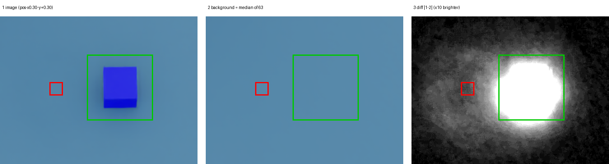

# 撮影結果を自動で検証する

## 今回の目的

10/7に、ラベルと画像が1枚ずれる問題（1つ前の位置が写っていた）を見つけた。
人が投影計算と画像を見比べて、ようやく気づいた問題だった。
[`verify_dataset.py`](../scripts/verify_dataset.py) は、同じ見落としを撮影のたびに自動で見つけるためのスクリプト。

コードは本人が入力し、4段階で一段ずつ足した。段階1・2は2026-10-08、段階3・4は2026-10-13に実行して確かめた。

| 段階 | 内容 | 主な関数 |
|---|---|---|
| 1 | USDからカメラ設定を読み、3D座標を画素位置に変換する | `load_camera`・`project` |
| 2 | `labels.csv` の9行を読み、すべて投影する | `read_labels` |
| 3 | 画像から部品を探し、計算位置とのずれを測る | `load_image`・`find_part` |
| 4 | 1つ前の位置に残像がないかを測る | `ghost_level` |

## 実行場所と使い方

- **実行場所**: `.venv` の通常のPython（Isaac Simの外）。
  USD・画像・CSVを読むだけなので、[06](06-position-dataset-script.md) の撮影スクリプトと違ってIsaac Simを起動しなくてよい。
- **実行方法**（Git Bash、`robot-sim-lab` で）:

  ```bash
  .venv/Scripts/python.exe scripts/verify_dataset.py
  ```

- **入力**: `workcell-v02-camera.usd`（カメラ設定）、`outputs/v02/labels.csv`、`outputs/v02/*.png`
- **警告**: `/World/robot` のfranka参照が読めないという `Warning` が出る。
  ロボットがネット上のファイルを参照しているためで、使うのはカメラだけなので結果には影響しない。

## なぜこの構成にしたか

```text
import            … 使う道具箱を持ってくる
設定値（大文字）  … パス・画像サイズ・しきい値。変えたくなったらここだけ触る
def 関数たち      … 1つの関数に1つの仕事（カメラを読む／投影する／CSVを読む）
main() の呼び出し … 道具を順番に使って、実際の処理を流す
```

- **段階ごとに確かめられる**: 段階1では `load_camera` と `project` だけを作り、試し計算（供給目印の投影）で正しさを確かめた。
  正しいと分かった部品の上に次の段階を積むので、エラーが出たときに疑う範囲が狭い。
- **使い回せる**: `project` は段階2でも3でも使う。将来、CSVに画素座標を追加するときにもそのまま使える。
- **撮影と検証を分ける**: 撮影はIsaac Sim内、検証は普通のPython。検証は何度でも気軽に回せる。

## `def main():` と最後の `main()`

- `def main():` は「mainという名前の手順書を登録する」だけで、この時点では中身は動かない。
- 最後の行の `main()` が「登録した手順書を今実行する」合図。
- Pythonはファイルを上から順に読む。`def` の段階では覚えるだけで、最後の `main()` に来て初めて処理が流れる。
  最後の行を消すと、何も表示されずに終わる。
- `main()` の中から `load_camera()` や `project()` を呼ぶと、それぞれの手順書が実行される（手順書の入れ子）。

## 投影計算（`project`）: 3D位置を画素位置に変える

```python
p = world_to_cam.Transform(Gf.Vec3d(x, y, z))   # ① カメラから見た位置に言い直す
depth = -p[2]                                   # ② 奥行き
u = WIDTH / 2 + scale * p[0] / depth            # ③ 横の画素位置
v = HEIGHT / 2 - scale * p[1] / depth           # ④ 縦の画素位置
```

1. **カメラ基準に言い直す**: 部品の座標は、作業台の原点から見た位置。
   これを「カメラから見て右に `p[0]`、上に `p[1]`、奥に `p[2]`」に変換する。
   変換には、カメラの「ローカル→ワールド変換」（`ComputeLocalToWorldTransform`）の逆（`GetInverse()`）を使う。
   USDのカメラは −Z 方向を向く決まりなので、カメラの前にある物は `p[2]` がマイナスになる。
2. **奥行き**: `-p[2]` で符号を反転し、「カメラから何m先か」を正の数にする。
3. **ずれ ÷ 奥行き**: 遠近法の核心。同じ「右に10cm」でも、1m先なら大きく、2m先なら半分しかずれて見えない。
   横のずれを奥行きで割って、見かけの角度にする。
   これに倍率 `scale` を掛けると画素数になる。
   - `scale = 焦点距離 ÷ 水平アパーチャ × 横幅` = 18.15 ÷ 20.955 × 1280 = **1108.5**
   - 意味: 奥行き1mのところで1m横にずれると、1108.5px動く。
   - 最後に `WIDTH / 2`（640）を足す。ここまでは「画面中央からのずれ」で、画素の番号は左端を0として数えるため。
4. **縦も同じ。ただし引き算**: カメラ座標は上がプラスだが、画像の行番号は上から下へ増える。
   向きが逆なので、`HEIGHT / 2`（360）からずれを引く。

**供給目印 (0.5, 0, 0.001) での実例:**

| | 中央からのずれ ÷ 奥行き | × 1108.5 | 画素位置 |
|---|---|---|---|
| 横 | −0.190（左寄り） | −210.4 | 640 − 210.4 = **429.6** |
| 縦 | −0.198（カメラから見て下） | −219.2 | 360 + 219.2 = **579.2** |

10/7の画像では (428, 580) に写っていたので、計算が合っている。
段階3では、このu, vを「計算上ここに写るはず」の位置として使い、実際の画像と比べる。

## 段階2: CSVを読む（`read_labels`）

- `csv.DictReader`: 撮影で使った `csv.writer` の読み込み版。1行目の見出し `image,x,y,z` を鍵にして、各行を辞書で返す（`row["x"]`）。
- `list(...)`: `with` を抜けるとファイルが閉じて読めなくなるので、その前に全行をリストにしておく。
- `float(...)`: CSVの値は数字に見えても文字列（`"0.35"`）。計算する前に小数に変換する。
- f文字列の中で `row['image']` を `'` で書くのは、外側の `"` と区別するため。

実行結果: Xが0.1増えるごとに縦+約80、Yが0.2増えるごとに横+約160。10/7の観察と同じ向き。

## 遭遇したエラー

| エラー | 原因 | 読み方 |
|---|---|---|
| `AttributeError: 'Camera' object has no attribute 'GetFocallLengthAttr'` | `l` が1つ多い | `Did you mean:` に正解が出る |
| `AttributeError: module 'pxr.Gf' has no attribute 'vec3d'` | `V` は大文字 | Pythonは大文字と小文字を区別する |

- Tracebackは下から読む。最後の行が原因、その上の `File ..., line N` が場所。
- USDライブラリでは、型（`Vec3d`、`Camera`）もメソッド（`GetFocalLengthAttr`）も大文字で始まる。
  Pythonで一般的な小文字の書き方（`get_focal_length`）とは違う。
- `Vec3d` は Vector・3つの数・double（倍精度の小数）の略。

## 段階3: 画像から部品を探す（`load_image`・`find_part`）

### 考え方: 9枚の中央値を背景にする

部品は1枚に1つ、毎回違う場所に写る。ある画素に部品が写るのは、9枚のうち多くて1枚。
そこで画素ごとに9枚の値を並べて真ん中（中央値）をとると、部品の写った1枚は外れ値として無視され、「部品のない作業台」が残る。
背景を別に撮影しなくてよいのが利点。

各画像と背景の差が大きい画素が、部品の写っている場所。

### 追加した設定値

```python
WINDOW = 40           # 計算位置の ±40px を探す
PART_THRESHOLD = 60   # 背景との差が60を超えたら部品の画素とみなす
MAX_ERROR_PX = 5      # 計算位置と5px以内ならOK
```

### `load_image`: 画像を数の表にする

```python
return [np.asanyarray(Image.open(DATA_DIR / row["image"]).convert("RGB")).astype(int) for row in rows]
```

- `Image.open(...).convert("RGB")`: PNGを開き、赤・緑・青の3色にそろえる（透明度の列があっても落とす）。
- `np.asanyarray(...)`: 画像を「縦720 × 横1280 × 3色」の数の表（配列）にする。
- `.astype(int)`: 元の型は0〜255しか入らない `uint8`。そのまま引き算すると、`10 - 20` が `246` に化ける（下に回り込む）。
  先に普通の整数にしておく。
- `[... for row in rows]`: リスト内包表記。CSVの行ごとに画像を読み、リストにまとめる。

### `main` での背景と差

```python
background = np.median(images, axis=0)           # 9枚を重ねた方向で中央値
diff = np.abs(image - background).sum(axis=2)    # 色ごとの差の絶対値を、3色ぶん足す
```

- `axis=0` は「9枚の並び」の方向。画素ごと・色ごとに中央値をとるので、結果は画像1枚と同じ形になる。
- `axis=2` は「3色」の方向。足すと色の次元が消え、縦720 × 横1280 の「差の地図」になる。

### `find_part`: 計算位置のまわりで部品の中心を求める

```python
u0, v0 = int(u) - WINDOW, int(v) - WINDOW
window = diff[v0:v0 + 2 * WINDOW, u0:u0 + 2 * WINDOW]
vs, us = np.nonzero(window > PART_THRESHOLD)
if len(us) == 0:
    return None
return u0 + us.mean(), v0 + vs.mean()
```

1. 計算位置から左上へ40px戻った点を窓の起点にする。
2. 配列の切り出しは `[縦, 横]` の順。画像の座標 `(u, v)` は横・縦の順なので、**逆になる**点に注意。
3. `np.nonzero(条件)`: 条件を満たす画素の「行番号の列」と「列番号の列」を返す。
4. 1つもなければ `None`（見つからない）を返す。`main` 側はNGとして次の画像へ進む。
5. 見つかった画素の平均位置が部品の中心。窓の中の番号なので、起点 `u0, v0` を足して画像全体の番号に戻す。

### 結果

```text
pos-x0.35-y-0.20.png: OK 計算(275.1,460.4)画像(276.2, 460.9)ずれ1.2
...
pos-x0.55-y-0.20.png: OK 計算(259.3,620.2)画像(261.1, 620.6)ずれ1.9
```

9枚ともOK。ずれは0.5〜1.9px。10/8の試作版と同じ値。

## 段階4: 残像を測る（`ghost_level`）

### 考え方: 1つ前の位置を見る

10/7、撮影前の待ちが3フレームだと、直前の位置に薄い残像が写った。
残像が出るなら、場所は「1つ前に撮った位置」。そこで背景との差を測り、何もない場所と同じ程度ならOKとする。

- 1枚目の「1つ前」は、撮影開始時に部品がいる `HOME = (0.5, 0.0, 0.0258…)`。
- 10/7の手作業の測定と同じく、±8pxの範囲の差の**平均**を使う。部品の中心を探す段階3とは違い、ここでは位置ではなく「どれだけ写っているか」を知りたい。

### 追加した設定値と関数

```python
GHOST_WINDOW = 8       # 前の位置の ±8px で測る
GHOST_THRESHOLD = 7    # 平均の差が7を超えたら残像あり

def ghost_level(diff, u, v):
    u0, v0 = int(u) - GHOST_WINDOW, int(v) - GHOST_WINDOW
    return diff[v0:v0 + 2 * GHOST_WINDOW, u0:u0 + 2 * GHOST_WINDOW].mean()
```

しきい値7の根拠（10/7と10/13の実測）:

| 場所 | 背景との差 |
|---|---|
| 何もない場所 | 0〜4 |
| 残像なし（30フレーム待ち、今回の9枚） | 0.7〜4.3 |
| 残像あり（3フレーム待ち、10/7） | 9〜29 |
| 部品 | 190〜330 |

残像なしの最大4.3と、残像ありの最小9の、ほぼ中間をとった。

### `main` の変更（4行追加・2行変更）

```python
    prev = HOME                                    # ループの前: 1枚目の「前の位置」
    for row, image in zip(rows, images):
        ...
        diff = ...
        pu, pv = project(world_to_cam, scale, *prev)
        ghost = ghost_level(diff, pu, pv)
        prev = (x, y, z)                           # 次の画像のために今の位置を覚える
        found = find_part(diff, u, v)
        ...
        result = "OK" if error <= MAX_ERROR_PX and ghost <= GHOST_THRESHOLD else "NG"
```

- `*prev`: タプルの中身を3つの引数に分けて渡す書き方。`project(..., prev[0], prev[1], prev[2])` と同じ。
- `prev = (x, y, z)` は `continue` より**前**に置く。後ろに置くと、部品が見つからなかった画像で更新が飛ばされ、次の画像が2つ前の位置と比べられてしまう。
- `and`: 位置のずれと残像の両方が基準内のときだけOK。

### 結果

```text
pos-x0.35-y-0.20.png: OK 計算(275.1,460.4)画像(276.2, 460.9)ずれ1.2 残像0.9
pos-x0.35-y+0.00.png: OK 計算(431.9,457.9)画像(432.2, 457.6)ずれ0.5 残像2.6
pos-x0.35-y+0.20.png: OK 計算(588.4,455.5)画像(587.6, 456.0)ずれ1.0 残像1.5
pos-x0.45-y-0.20.png: OK 計算(267.4,538.3)画像(268.2, 538.5)ずれ0.8 残像2.6
pos-x0.45-y+0.00.png: OK 計算(428.0,535.7)画像(428.6, 536.6)ずれ1.0 残像2.9
pos-x0.45-y+0.20.png: OK 計算(588.4,533.2)画像(587.5, 532.5)ずれ1.1 残像1.3
pos-x0.55-y-0.20.png: OK 計算(259.3,620.2)画像(261.1, 620.6)ずれ1.9 残像1.4
pos-x0.55-y+0.00.png: OK 計算(424.0,617.4)画像(425.0, 616.9)ずれ1.2 残像4.3
pos-x0.55-y+0.20.png: OK 計算(588.5,614.7)画像(587.8, 615.3)ずれ0.9 残像0.7
```

9枚ともOK。

**未検証**: NGになる場合（残像ありの画像）は確かめていない。3フレーム待ちの画像が残っていないため。
確かめるには、3フレーム待ちで撮り直して実行する。

### 途中で起きたこと

古い `result =` と `print(...)` の行を残したまま新しい行を足したため、1枚につき2行表示された。
判定は後の `result =` で上書きされるので正しかったが、古い2行を消して1行表示にした。
「置き換え」の指示では、新しい行を書いたあとに古い行を消す。

## 検出の仕組み（図解）



v03の `pos-x0.30-y+0.30.png` を拡大したもの。緑の枠は部品を探す範囲（±40px）、赤い枠は残像を測る範囲（1つ前の位置の±8px）。

1. **画像を数の表にする**（`load_image`）: 1画素は赤・緑・青の3つの数（0〜255）。床は (77, 123, 162)、部品は (44, 42, 225) のようになる。
2. **背景を作る**（`np.median(images, axis=0)`、図の2枚目）: 同じ画素の値を全画像ぶん並べて、真ん中の値をとる。
   ```text
   63枚の値: 162, 161, 162, 225(この1枚だけ部品), 162, 163, ...
   並べ替え: 161, 162, 162, 162, 163, ..., 225   → 真ん中 = 162（床の色）
   ```
3. **差の地図を作る**（`np.abs(image - background).sum(axis=2)`、図の3枚目。明るさ10倍）:
   床は `|77-77| + |123-123| + |162-162|` ≈ 0（黒）、部品は `|44-77| + |42-123| + |225-162|` ≈ 177（白）。
4. **部品を探す**（`find_part`、緑の枠）: 差が60を超える画素の平均位置が部品の中心。
5. **残像を測る**（`ghost_level`、赤い枠）: 1つ前の位置の差の平均。部品がいなければ0に近い。

色そのもの（「青いから部品」）ではなく、「背景からどれだけ数字が変わったか」で見ている。部品が何色でも、床と違えば同じコードで見つかる。

### 使っているライブラリの役割

| ライブラリ | 担当 | このスクリプトで使っている所 |
|---|---|---|
| Pillow（`from PIL import Image`） | 画像ファイルの読み書き | `Image.open(...).convert("RGB")` だけ |
| NumPy（`import numpy as np`） | 数の表の計算 | 中央値・差・絶対値・合計・平均・条件で選ぶ、すべて |

NumPyは画像処理専用ではなく、汎用の配列計算ライブラリ。`np.asanyarray` で変換した後は、NumPyにとってはただの「720×1280×3 の数の表」。
画像処理専用のライブラリにはOpenCV（`cv2`）、scikit-image、SciPy（`scipy.ndimage`）があり、どれもNumPyの配列を受け渡す。
部品の外形（四角形の枠）を取りたくなったら、OpenCVの出番。

## 63点撮影で分かったこと（2026-10-13）

撮影点をX 0.30〜0.60（0.05刻み）× Y −0.4〜+0.4（0.1刻み）の63点に増やした（v03: 30フレーム待ち、v04: 60フレーム待ち）。
位置は63枚ともOKだったが、v03で残像のNGが4枚（7.8〜8.6）出た。

### にじみが残像の測定に入る

図の3枚目では、部品のまわりにぼんやりした灰色のにじみ（影・照り返し）が広がり、赤い枠にかかっている。
部品の中心からの距離ごとの差（v04、横方向）:

| 距離 | 40px | 60px | 80px | 120px |
|---|---|---|---|---|
| 差 | 21〜41 | 9〜13 | 約4 | 約1.4 |

Y 0.1刻みでは、隣の撮影点がちょうど約80px先にある。そのため「前の位置」の値ににじみが足されて、しきい値7を超えた。
v02は0.2刻み（約160px）だったので影響がなかった。

確かめ方: 同じ列で、前の位置（部品がいた）と次の位置（まだ部品が来ていない）を比べた。v03は4.4と3.6、v04は3.7と4.4。
残像なら前の位置だけが高くなるはずなので、v03のNGはほぼ誤検出と判断した。

### 照りや影は数字に出ている。見分けられないのは「理由」

| 原因 | 赤い枠の中の差 |
|---|---|
| 今の部品の影・照り返しが届いている | 約4〜8 |
| 前の位置に残像が残っている | 数〜数十 |

どちらも「背景から少し変わった」という同じ形で出る。差の大きさだけを見る今の方法では、理由を区別できない。
対策は、影が届かない場所でだけ残像を測ること。撮影の順番を変えて、連続する2点を約160px以上離す（[reader.md](../reader.md) の「次回の開始点」）。
