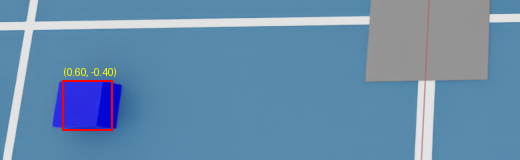

# ラベル位置を画像に重ねて目視確認する

## 今回の目的

計画のステップ2「少量の画像に正解データを重ねて目視確認する」。
[`verify_dataset.py`](../scripts/verify_dataset.py) は数値でずれを測るが、人の目で「ラベルが部品を指しているか」を一度に見られる形も作る。
[`overlay_labels.py`](../scripts/overlay_labels.py) は、`labels.csv` の座標を画素位置に投影し、画像に赤い枠を描いて保存する。

コードは本人が入力し、2026-10-14 に v05（63枚）で実行して確かめた。

## 実行方法

Git Bash で `robot-sim-lab` フォルダから実行する。Isaac Sim の Script Editor ではなく、`.venv` の Python で動く。

```bash
.venv/Scripts/python.exe scripts/overlay_labels.py
```

出力先は `outputs/v05/overlay/`（`verify_dataset.py` の `DATA_DIR` の下）。元の画像は書き換えない。

| 出力 | 内容 |
|---|---|
| `pos-*.png`（63枚） | 等倍の画像に、ラベル位置を中心とした赤い四角（50px）と座標の文字を描いたもの |
| `sheet.png` | 63枚を1/4に縮小し、横9枚×縦7段に並べた一覧。並びは撮影順 |

## 構成

| 部分 | 役割 |
|---|---|
| `from verify_dataset import ...` | カメラの読み込み・投影・CSV読み込みを `verify_dataset.py` から借りる |
| `draw_mark` | 四角と（あれば）文字を描く。等倍用と縮小用で大きさを変えて2回呼ぶ |
| `main` | 1行ずつ投影 → 等倍に描いて保存 → 縮小に描いて一覧に貼る → 一覧を保存 |

### `if __name__ == "__main__":` を足した理由

`import` すると、読み込んだファイルは上から全部実行される。`verify_dataset.py` の最終行が `main()` のままだと、
`overlay_labels.py` から関数を借りただけで、検証も63行分実行されてしまう。

`__name__` には、ファイルを直接実行したときだけ `"__main__"` が入り、`import` されたときはファイル名（`"verify_dataset"`）が入る。
そこで最終行を次のようにすると、直接実行したときだけ `main()` が動く。

```python
if __name__ == "__main__":
    main()
```

初回はこの変更が保存されておらず、検証結果が63行表示され、USDの警告も2回出た（カメラを2回読んだため）。
直した後は警告1回と `Saved ...` の1行だけになった。`verify_dataset.py` を直接実行したときの動きは変わらない。

### 縮小してから描く

先に等倍で描いてから縮小すると、幅2pxの線が1/4になって消える。
そのため `thumb = image.resize(...)` で先に縮小版を作り、座標にも `THUMB_SCALE` を掛けて、縮小版に別に描いている。
初回は等倍に描く2行（`draw_mark(image, ...)` と `image.save(...)`）が抜けていて、`sheet.png` だけが保存された。

## 結果（v05）

63枚すべてで、赤い枠が部品に重なった。外れたものはない。



枠は部品の上の面にはほぼ合うが、手前に見える側面がはみ出す。
投影しているのは部品の中心の1点で、枠の大きさ（`MARK = 25`）は決め打ちのため。
検出モデルの正解に使う枠（バウンディングボックス）にするなら、立方体の8つの角を投影して、その外側を囲む必要がある。
